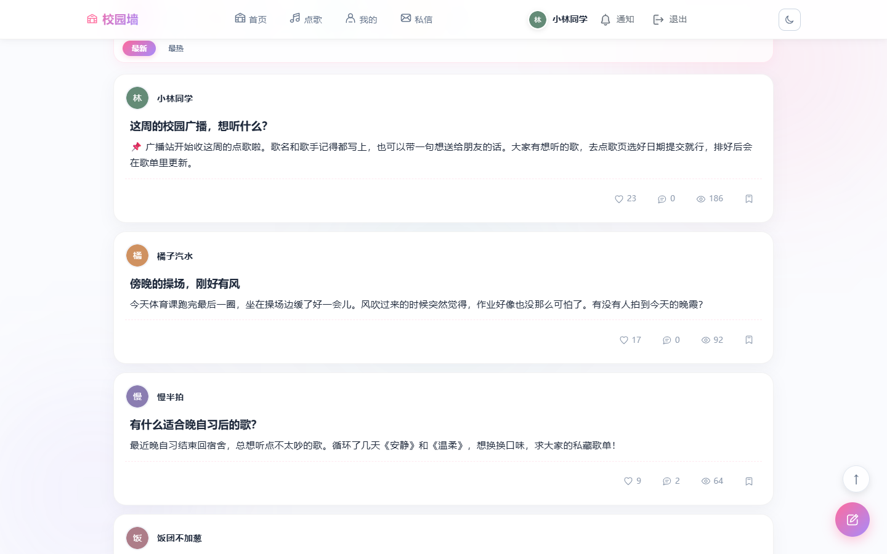
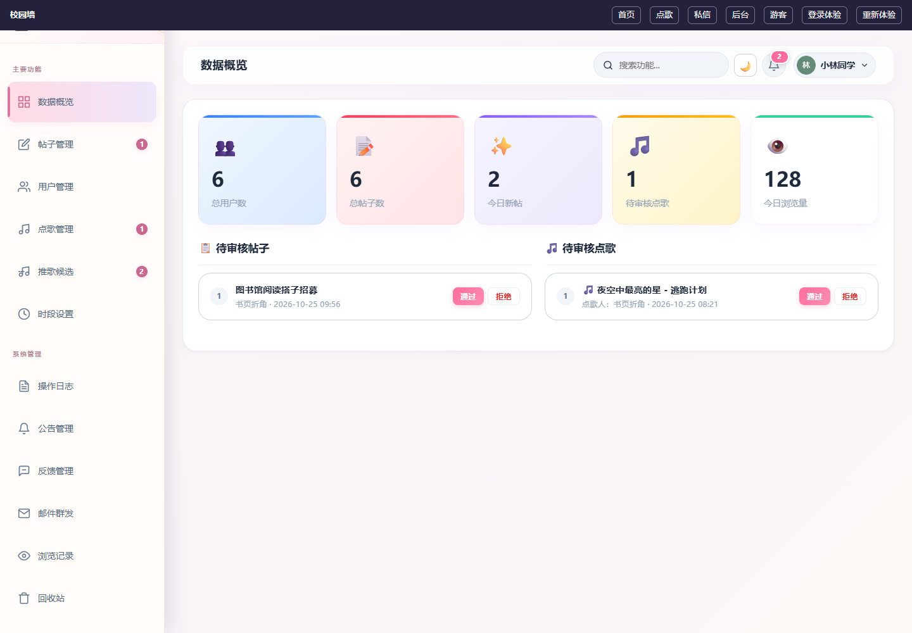
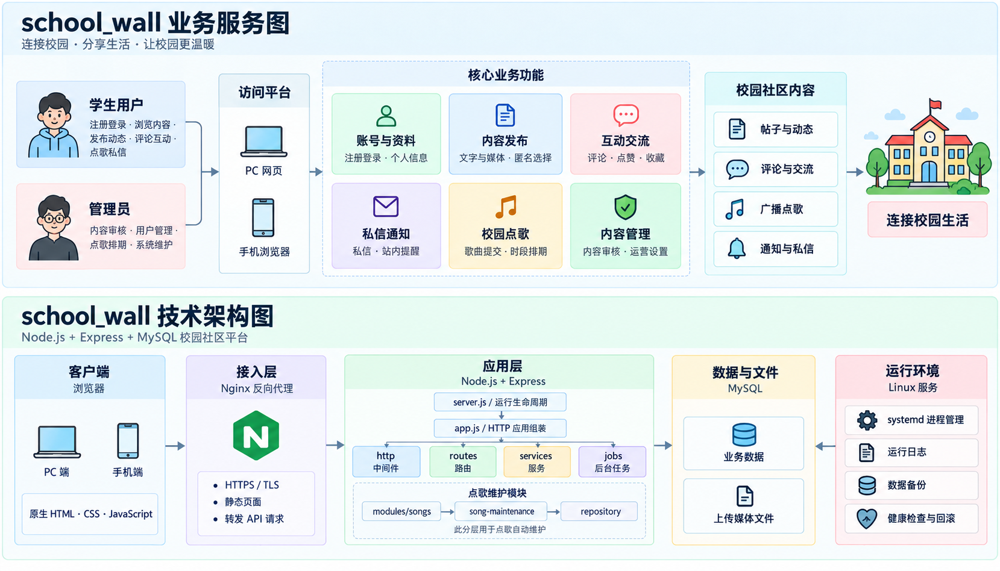

<p align="center">
  
</p>
<h1 align="center">校园墙 · Campus Wall</h1>
<p align="center">让校园里的消息、交流与音乐，有一个共同的去处。</p>
<p align="center">
  <a href="https://github.com/Jay1023CN/school_wall/actions/workflows/ci.yml"></a>
  
  <a href="LICENSE"></a>
</p>
<p align="center">
  <a href="https://jay1023cn.github.io/school_wall/"><b>在线体验</b></a> ·
  <a href="#快速启动">快速启动</a> ·
  <a href="docs/README.md">项目文档</a> ·
  <a href="CONTRIBUTING.md">参与开发</a>
</p>

校园墙是一套可自行部署的校园社区，包含动态发布、评论私信、广播点歌、公众号内容整理与管理后台。前端使用原生 HTML、CSS 和 JavaScript，服务端使用 Express，数据存储在 MySQL。



## 可以做什么

| 日常交流 | 内容运营 | 后台管理 |
| --- | --- | --- |
| 动态、图片、投票与评论回复 | 广播点歌、审核与歌单 | 帖子、账号、公告与反馈管理 |
| 匿名发布、收藏与关注 | 公众号文章预览、排版与草稿同步 | 按角色划分操作权限 |
| 私信、站内通知与签到积分 | 可选邮件通知、微信与 AI 服务 | 操作日志、回收站与运行检查 |

桌面端与移动端共用一套源码，支持深浅色主题。点歌、发帖、评论等写入包含事务与幂等处理；公众号同步和通知任务保存在数据库中。

<details>
<summary><b>查看移动端与管理后台</b></summary>

<p align="center"></p>



</details>

截图来自内置演示，使用示例数据。演示操作保存在当前浏览器中，可通过顶部“重新体验”恢复初始内容；不会发送真实邮件或创建公众号草稿。

## 快速启动

准备 **Node.js 20+、npm 和 MySQL**，然后安装依赖：

```bash
git clone https://github.com/Jay1023CN/school_wall.git
cd school_wall
npm ci
```

将 [`config/env.example`](config/env.example) 复制为根目录 `.env`：

```powershell
# Windows PowerShell
Copy-Item config/env.example .env
```

macOS / Linux 使用 `cp config/env.example .env`。已有配置时直接编辑，避免覆盖原文件。填写数据库连接信息，并为 `JWT_SECRET` 设置随机密钥：

```bash
node -e "console.log(require('crypto').randomBytes(32).toString('hex'))"
npm start
```

默认访问 **http://localhost:3000**。服务启动时初始化数据库结构；`.env.local` 可覆盖 `.env` 的同名配置。开发时使用独立数据库。

**创建首个管理员：** 在私有配置中填写 `INITIAL_ADMIN_USERNAME`、`INITIAL_ADMIN_PASSWORD`（至少 12 位）及可选的 `INITIAL_ADMIN_NICKNAME`，再运行 `npm run admin:create`。该命令不会覆盖已有账号。

微信、邮件、AI 和天气按需配置。公开版没有学校名称、学校地址、专属站点标识或默认天气位置；部署前填入自己的配置和资源。

## 开发与检查

| 命令 | 用途 |
| --- | --- |
| `npm run dev` | 监听服务端文件变化 |
| `npm test` | 运行完整回归检查 |
| `npm run sync:frontend` | 将前端源码同步到运行镜像 |
| `npm run check:mirrors` | 核对源码与运行镜像 |
| `npm run check:privacy` | 检查凭据、学校标识、仓库链接及原站点图片 |
| `npm run check:deployment` | 检查部署、回滚和静态缓存流程 |
| `npm run build` | 生成静态文件与哈希清单 |
| `npm run build:demo` | 生成独立的浏览器演示 |

修改页面后，先同步镜像，再运行相关检查。生产服务当前提供 `public/`，`dist/` 是构建产物。部署脚本要求显式填写 `DEPLOY_REPO_URL`，不会默认拉取其他站点的仓库。

## 文档导航

| 文档 | 内容 |
| --- | --- |
| [项目文档](docs/README.md) | 按用途查找说明 |
| [源码索引](docs/PROJECT_INDEX.md) | 页面、接口、服务与测试入口 |
| [架构与维护](docs/ARCHITECTURE.md) | 生命周期、事务、后台任务、部署和回滚 |
| [后台维护](docs/ADMIN_UI_MAINTENANCE.md) | 后台样式与模块边界 |
| [公众号配置](docs/订阅号配置说明.html) | 回调、绑定及配置流程 |
| [演示说明](docs/PAGES_DEMO.md) | 演示构建、预览与自动发布 |
| [公开版本说明](docs/PUBLIC_RELEASE.md) | 脱敏范围与实际验证 |

<details>
<summary><b>查看业务与技术架构图</b></summary>



</details>

## 参与与许可

欢迎通过 Issue 反馈问题，或按 [贡献说明](CONTRIBUTING.md) 提交修改。安全问题请参阅 [安全报告方式](SECURITY.md)。

项目使用 [Apache License 2.0](LICENSE)，分发时保留 [NOTICE](NOTICE) 中的作者归属。
